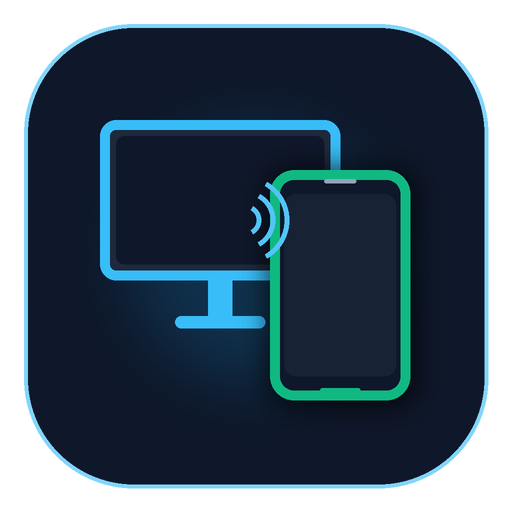

# 📱 PCcell - Integração Total entre PC e Celular

<p align="center">
  
</p>

<p align="center">
  <b>Transforme seu smartphone em um controle avançado, touchpad, tela remota em 60Hz, webcam e central de comandos para o seu computador.</b>
</p>

<p align="center">
  
  
  
  
</p>

---

## 🚀 Sobre o Projeto

O **PCcell** é um ecossistema completo cliente-servidor de alta performance e baixa latência que conecta diretamente um computador Windows a um celular Android via **Wi-Fi local** ou **cabo USB (ADB Reverse)**, sem depender de nuvens externas ou intermediários de terceiros.

> 🤖 **Nota de Desenvolvimento:**  
> Este projeto foi concebido e implementado com o suporte e assistência de **Inteligência Artificial (IA)**, acelerando a prototipagem, design de arquitetura, otimização de renderização a 60Hz e construção da interface móvel e desktop.

---

## ✨ Funcionalidades Principais

### 🖥️ 1. Ver Tela em Tempo Real (60Hz Remote Desktop)
- Streaming contínuo da área de trabalho do PC para o celular em **~60 FPS** com aceleração direta em memória e compactação JPEG dinâmica.
- **Touchpad na tela:** deslize suavemente para movimentar o cursor com precisão (sem risco de arrastar janelas acidentalmente). Toque rápido realiza o clique primário.
- **Botões Dedicados de Clique:** dock flutuante inferior com botões ergonômicos para **Clique Esquerdo** (com suporte a clique e arraste contínuo) e **Clique Direito**.

### 🎮 2. GamePad Virtual Ergonômico (Modo Paisagem)
- Ativação automática no **modo horizontal (widescreen)** ao abrir.
- **D-Pad em cruz gigante** de alta precisão táctil.
- **Botões de Ação ABXY estilo console** (Y amarelo, X azul, B vermelho, A verde) com resposta multi-touch independente.
- **Gatilhos de Ombro:** L1, L2, R1, R2 no topo com feedback tátil.
- **Botões L3 e R3** para cliques de analógico.

### 📁 3. Transferência de Arquivos & Explorador Remoto
- Compartilhamento bidirecional ultrarrápido de arquivos de qualquer tamanho via socket TCP com barra de progresso em tempo real.
- **Navegador de Pastas do PC:** navegue pelas unidades e pastas do computador diretamente da tela do celular e baixe arquivos com 1 toque.

### 📋 4. Sincronização de Área de Transferência (Clipboard)
- Envio instantâneo de texto digitado no celular para a área de transferência do Windows.
- **Foto Direta para o Ctrl + V:** tire uma foto com a câmera do celular e ela é colada instantaneamente no clipboard do computador, pronta para ser colada no WhatsApp Web, Photoshop, Word ou Discord com um simples `Ctrl + V`.

### 📷 5. Estúdio de Câmera & Webcam Sem Fio
- Interface dedicada em tela cheia com alternância instantânea entre **câmera frontal e traseira**.
- Transmissão ao vivo de vídeo do celular para ser utilizado como webcam do computador.

### 🎤 6. Microfone Sem Fio
- Gravação e streaming contínuo de áudio PCM em tempo real para reprodução de áudio diretamente nos alto-falantes do computador.
- Interface moderna com medidor de volume dinâmico e status visual pulsante.

### 🕹️ 7. Macro Deck (Stream Deck Integrado)
- Painel com atalhos essenciais do sistema:
  - 🚨 **Modo Pânico:** minimiza todas as janelas e muta o áudio do Windows instantaneamente.
  - 📋 **Gerenciador de Tarefas:** acionamento nativo via `Ctrl + Shift + Esc`.
  - 🖥️ Mostrar Desktop, Alternar Janelas (`Alt + Tab`), Fechar Janela (`Alt + F4`).
  - 🌐 Abrir Navegador, Spotify, Calculadora, Bloco de Notas e Explorador de Arquivos.

### ⚡ 8. Controle de Energia & Monitor de Hardware
- Comandos rápidos de Desligar, Reiniciar e Suspender o PC.
- Monitoramento em tempo real do uso de **CPU, Memória RAM e Disco** do computador.

---

## 🛠️ Arquitetura e Tecnologias

- **Lado PC (`pccell-PC`):**
  - Java 21 / Java Swing moderno (Dark Slate Theme).
  - `java.awt.Robot` para injeção de eventos de mouse, teclado e macros.
  - Servidor TCP Multi-Thread com enfileiramento assíncrono de I/O (`ExecutorService`).
  - Servidor UDP para **Descoberta Automática na Rede Local (Broadcast)**.
- **Lado Celular (`pccell-cell`):**
  - Android SDK (Java) com suporte a Material Design e layouts reativos.
  - Tratamento de mudanças de configuração (`android:configChanges`) para **manter a conexão ativa mesmo girando o aparelho** entre vertical e horizontal.
  - Multi-touch customizado para respostas simultâneas em jogos.

---

## 📦 Como Executar

### 1. Servidor no PC
```bash
# Compilar o código do PC
javac --release 21 -d pccell-PC/out/production/project pccell-PC/project/src/*.java

# Gerar o executável ou rodar o JAR
java -cp pccell-PC/out/production/project Main
```

### 2. Aplicativo no Celular
```bash
# Compilar e instalar via Gradle (com celular conectado via USB com depuração ativada)
cd pccell-cell
./gradlew assembleDebug
adb install -r app/build/outputs/apk/debug/app-debug.apk

# (Opcional) Para conectar via USB sem precisar do Wi-Fi:
adb reverse tcp:5050 tcp:5050
```

---

## 📄 Licença

Distribuído sob a licença MIT. Consulte `LICENSE` para mais informações.
